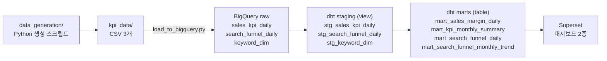

# 이커머스 Grocery 카테고리 KPI·검색 퍼널 분석 파이프라인

BigQuery · dbt · Superset으로 매출·마진 KPI와 검색 퍼널 전환율을 모델링하고, 대시보드로 확인하도록 설계한 데이터 분석 포트폴리오입니다.

> **모든 데이터는 가상(synthetic) 데이터이며 실제 회사 데이터가 아닙니다.**

**현재 상태:** 코드·데이터·설계 문서 작성 완료 / BigQuery 적재, dbt 실행, Superset 대시보드 구축은 아직 실행 전입니다. ([진행 상황](#8-진행-상황) 참고)

---

## 1. 비즈니스 문제

이커머스 Grocery 카테고리 운영에서 반복적으로 필요한 두 가지 질문을 다룹니다.

1. **매출·마진 KPI 관리** — 서브카테고리별 GMV·매출·순마진율을 같은 정의로 월 단위로 보고, 전월(MoM)·전년 동월(YoY) 대비 변화를 파악한다.
2. **검색 퍼널 전환율 개선** — 노출 → 클릭 → 상세페이지(SDP) → 장바구니 → 구매 중 어느 단계에서 이탈이 큰지, 전환율이 월별로 개선되고 있는지 확인한다.

분석 범위는 Grocery 카테고리의 서브카테고리 6개, 기간은 2023-01-01 ~ 2025-12-31(3년, 일 단위)입니다.

| 카테고리 그룹 | 서브카테고리 |
|---|---|
| Beverages | Drinks, Water |
| Snacks, Coffee & Tea | Snacks, Coffee & Tea |
| Meal & Healthy | Meal Essentials, Healthy Food |

## 2. 아키텍처



- BigQuery 리전: `asia-northeast3`(서울). raw 테이블은 날짜 파티션, 서브카테고리(·키워드) 클러스터링.
- staging은 view, marts는 table로 생성 (`dbt_project.yml`).
- 대시보드는 매출/마진 KPI, 검색 퍼널 2종으로 설계 (`superset_portfolio/dashboard_design_spec.md`).

## 3. 가상 데이터 설계

데이터는 `data_generation/`의 스크립트로 생성했습니다. 아래 수치는 모두 스크립트에 설정한 **가정**입니다.

### 매출·마진 (`generate_fifo_kpi_v2.py` → `sales_kpi_daily.csv`)

- 그레인: 서브카테고리 × 일자 (6 × 1,096일 = 6,576행)
- 원가: 서브카테고리별로 7일마다 입고 배치를 만들고, FIFO(선입선출)로 매출원가를 계산
- 판매가: 원가 × 마크업. 마크업은 서브카테고리별 **목표 순마진율**에서 역산한 값
- 계절성: 6~8월 서브카테고리별 가중(Water +45%, Drinks +35%, Coffee & Tea −10% 등), 12월 +8%, 주말 ×1.06
- 펀딩·비용: GMV 대비 비율로 광고·리베이트·리뷰 프로그램·데이터 인사이트 지원금을 만들고, 각 지원금의 일정 비율을 비용으로 차감

| 서브카테고리 | 목표 순마진율 (생성 단계 설정) |
|---|---|
| Drinks | 35~38% |
| Water | 45~48% |
| Snacks | 20%대 초중반 |
| Coffee & Tea | 약 35% |
| Meal Essentials | 약 35% |
| Healthy Food | 38~40% |

### 검색 퍼널 (`generate_search_funnel.py` → `search_funnel_daily.csv`, `keyword_dim.csv`)

- 그레인: 키워드 × 서브카테고리 × 일자 (키워드 60개 × 1,096일 = 65,760행)
- 키워드: 서브카테고리당 10개, 검색량 티어(High/Mid/Low)별로 노출 규모를 다르게 설정
- 시나리오: 상세페이지 개선 작업을 가정해 CTR·장바구니율·장바구니→구매 전환율이 3년간 완만하게 선형 상승하도록 설정 (키워드별 개선폭과 일별 노이즈 포함)

> 대시보드에 보이게 될 "퍼널 전환율 개선 추세"는 데이터를 만들 때 넣은 가정입니다. 분석으로 발견한 결과가 아닙니다.
>
> 매출·마진 데이터와 검색 퍼널 데이터는 서로 독립적으로 생성되어, 두 데이터의 GMV는 맞춰져 있지 않습니다.

## 4. 데이터 모델

| 레이어 | 테이블 | 그레인 | 행 수 | 설명 |
|---|---|---|---|---|
| raw | `sales_kpi_daily` | 서브카테고리 × 일자 | 6,576 | 매출·원가·펀딩·비용 원천 |
| raw | `search_funnel_daily` | 키워드 × 서브카테고리 × 일자 | 65,760 | 퍼널 단계별 건수 |
| raw | `keyword_dim` | 키워드 | 60 | 키워드 → 서브카테고리·검색량 티어 매핑 |
| staging | `stg_sales_kpi_daily` | 서브카테고리 × 일자 | — | 컬럼명 정리, 펀딩·비용 NULL → 0, 비정상 행 제외 |
| staging | `stg_search_funnel_daily` | 키워드 × 서브카테고리 × 일자 | — | 컬럼명 정리, 비정상 행 제외 |
| staging | `stg_keyword_dim` | 키워드 | — | 컬럼 선택 |

| mart | 그레인 | 답하는 질문 |
|---|---|---|
| `mart_sales_margin_daily` | 서브카테고리 × 일자 | 어느 서브카테고리가 어느 날 마진율이 낮았나? |
| `mart_kpi_monthly_summary` | 서브카테고리 × 월 | 이번 달 GMV·매출·순마진율이 전월·전년 동월 대비 어떻게 변했나? |
| `mart_search_funnel_daily` | 키워드 × 서브카테고리 × 일자 | 어떤 키워드가 퍼널의 어느 단계에서 이탈이 큰가? |
| `mart_search_funnel_monthly_trend` | 서브카테고리 × 월 | CTR·장바구니율·CVR이 월별로 개선되고 있나? |

## 5. 지표 정의

dbt 모델 SQL에 구현된 계산식 그대로입니다.

| 지표 | 계산식 | 구현 위치 |
|---|---|---|
| GMV | 원천 컬럼 `gmv`의 합계 (생성 단계에서 판매수량 × `unit_price_ex_vat`) | `mart_kpi_monthly_summary` |
| 순마진율 (일) | `net_gross_category_gp / revenue × 100` | `mart_sales_margin_daily` |
| 순마진율 (월) | `sum(net_gross_category_gp) / sum(revenue) × 100` | `mart_kpi_monthly_summary` |
| MoM 성장률 | `(당월 − 직전월) / 직전월 × 100` — GMV, 매출 각각 | `mart_kpi_monthly_summary` |
| YoY 성장률 | `(당월 − 12개월 전) / 12개월 전 × 100` — GMV, 매출 각각 | `mart_kpi_monthly_summary` |
| 순마진율 YoY | `당월 순마진율 − 전년 동월 순마진율` (%p) | `mart_kpi_monthly_summary` |
| CTR | `clicks / impressions × 100` | `mart_search_funnel_daily`, `_monthly_trend` |
| 장바구니율 | `add_to_cart / sdp_views × 100` | 〃 |
| CVR | `purchases / clicks × 100` | 〃 |

- 순마진율의 분모는 GMV가 아니라 **매출(revenue)** 입니다. CVR의 분모는 **클릭**입니다.
- 월 단위 비율은 일별 비율의 평균이 아니라 월 합계로 다시 계산합니다.
- 0으로 나누는 경우 `safe_divide`로 NULL 처리합니다. 마진율·성장률은 소수 둘째 자리, 퍼널 지표는 셋째 자리에서 반올림합니다.
- MoM·YoY는 `lag()`로 직전 행·12행 전을 가져오므로 월이 빠짐없이 이어져 있어야 합니다. 현재 데이터는 모든 서브카테고리가 36개월 모두 존재합니다.
- 순이익 계산: `net_gross_category_gp = (매출 − FIFO 매출원가) + 펀딩 합계 − 비용 합계` (생성 단계)

## 6. 데이터 품질

dbt test 23개를 정의했습니다 (source 7, staging 8, marts 8).

| 검증 | 대상 |
|---|---|
| `not_null` | 날짜, 서브카테고리, 키워드, 매출 등 핵심 키 컬럼 |
| `unique` | `keyword_dim.keyword` — 키워드가 서브카테고리 하나에만 매핑되는지 |
| `accepted_range` (dbt_utils) | 매출 ≥ 0, 순마진율 −100 ~ 100, CTR 0 ~ 100 |

staging 모델에서는 테스트와 별도로 다음 행을 걸러냅니다.

- 매출: `revenue < 0` 이거나 날짜가 NULL인 행
- 퍼널: `impressions < clicks`, `clicks < 0`, `sdp_views < 0`, 날짜 NULL인 행

**한계**

- 퍼널 필터는 노출 ≥ 클릭만 검사하고, 클릭 ≥ 상세페이지 ≥ 장바구니 ≥ 구매 순서는 검사하지 않습니다. (현재 CSV에서 역전된 행은 0건입니다.)
- `_staging__sources.yml`의 freshness 설정은 `dbt test`가 아닌 `dbt source freshness`로 실행되며, 데이터가 2025-12-31에서 끝나기 때문에 실행 시 에러가 납니다.
- 위 테스트는 아직 실제로 실행하지 않았습니다.

## 7. 실행 방법 (미검증)

아래 명령어는 저장소의 파일 기준으로 작성했으며, 아직 끝까지 실행해 보지 않았습니다.

```bash
# 0) 가상 데이터 생성 (CSV는 이미 kpi_data/에 포함되어 있어 생략 가능)
pip install numpy pandas
cd kpi_data
python ../data_generation/generate_fifo_kpi_v2.py
python ../data_generation/generate_search_funnel.py
cd ..

# 1) BigQuery 인증 및 raw 테이블 생성
gcloud auth application-default login
#    bq_dbt_portfolio/bigquery/raw_schema_bigquery.sql 을 BigQuery 콘솔에서 실행

# 2) CSV → BigQuery raw 적재 (기본 경로: 저장소 최상위 kpi_data/)
pip install google-cloud-bigquery
python bq_dbt_portfolio/bigquery/load_to_bigquery.py --project <GCP_PROJECT_ID>

# 3) dbt 변환 + 테스트
pip install dbt-bigquery
#    profiles.yml.example 을 ~/.dbt/profiles.yml 로 복사 후 <GCP_PROJECT_ID> 수정
cd bq_dbt_portfolio/dbt_portfolio
dbt deps
dbt build          # run + test

# 4) Superset
cd ../../superset_portfolio
docker compose up -d
#    이후 SUPERSET_SETUP.md 순서대로 BigQuery 연결, 데이터셋 등록, 차트 구성
```

## 8. 진행 상황

| 항목 | 상태 |
|---|---|
| 가상 데이터 생성 스크립트 | ✅ 작성 완료 |
| 가상 데이터 CSV (`kpi_data/`) | ✅ 저장소 포함 |
| BigQuery raw DDL, 적재 스크립트 | ✅ 작성 완료 |
| dbt staging·mart 모델 7개, 테스트 23개 | ✅ 작성 완료 |
| Superset 실행 환경, 대시보드 설계서 | ✅ 작성 완료 |
| 생성 스크립트 재실행 결과와 저장소 CSV 일치 확인 | ⬜ 미확인 |
| BigQuery 실제 적재 | ⬜ 실행 전 |
| `dbt run` / `dbt test` | ⬜ 실행 전 (테스트 통과 여부 미확인) |
| Superset 대시보드 구축 | ⬜ 실행 전 (화면 캡처 없음) |

## 9. AI 활용 안내

- **Claude(AI)** 를 SQL·Python·설정 파일 등 코드 구현과 문서 초안 작성 도구로 사용했습니다.
- 다음은 이커머스 카테고리 실무 경험을 바탕으로 본인이 정했습니다.
  - 분석 주제와 비즈니스 질문
  - 지표 선정과 정의 (순마진율·CVR 분모 선택 포함)
  - 카테고리·서브카테고리 구조
  - 서브카테고리별 목표 마진율 (데이터 생성 단계에서 설정, `generate_fifo_kpi_v2.py`의 `SUBCATS`)
  - 계절성, 퍼널 개선폭 등 가상 데이터 시나리오
  - 결과 해석과 생성된 코드 검토

## 10. 폴더 구조

```
practice_portfolio/
├── data_generation/                      # 가상 데이터 생성
│   ├── generate_fifo_kpi_v2.py           #   매출·마진 KPI (FIFO 원가 시뮬레이션)
│   └── generate_search_funnel.py         #   검색 퍼널 + 키워드 디멘션
├── kpi_data/                             # 생성된 가상 데이터 CSV
│   ├── sales_kpi_daily.csv
│   ├── search_funnel_daily.csv
│   └── keyword_dim.csv
├── bq_dbt_portfolio/
│   ├── bigquery/
│   │   ├── raw_schema_bigquery.sql       #   raw 데이터셋·테이블 DDL
│   │   └── load_to_bigquery.py           #   CSV → BigQuery raw 적재
│   └── dbt_portfolio/
│       ├── dbt_project.yml
│       ├── packages.yml                  #   dbt_utils
│       ├── profiles.yml.example          #   접속 프로필 예시 (실제 profiles.yml은 커밋 제외)
│       └── models/
│           ├── staging/                  #   stg_* 3개 + sources/테스트 정의
│           └── marts/                    #   mart_* 4개 + 테스트 정의
└── superset_portfolio/
    ├── docker-compose.yml                #   Superset + 메타 DB 로컬 실행
    ├── SUPERSET_SETUP.md                 #   BigQuery 연결·데이터셋 등록 가이드
    └── dashboard_design_spec.md          #   대시보드 2종 차트 설계
```

`.gitignore`로 `profiles.yml`, `*.json`(서비스 계정 키 등), `.env`, dbt 산출물은 저장소에서 제외합니다. `superset_portfolio/docker-compose.yml`의 비밀번호·시크릿 키는 로컬 데모용 기본값이므로, 외부에 배포할 때는 `.env`로 분리하고 값을 바꿔야 합니다.
